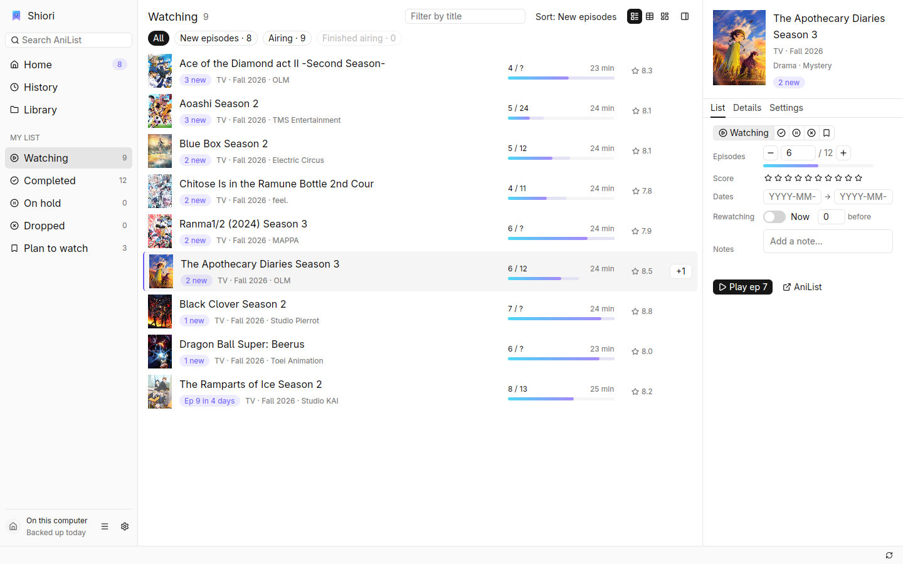
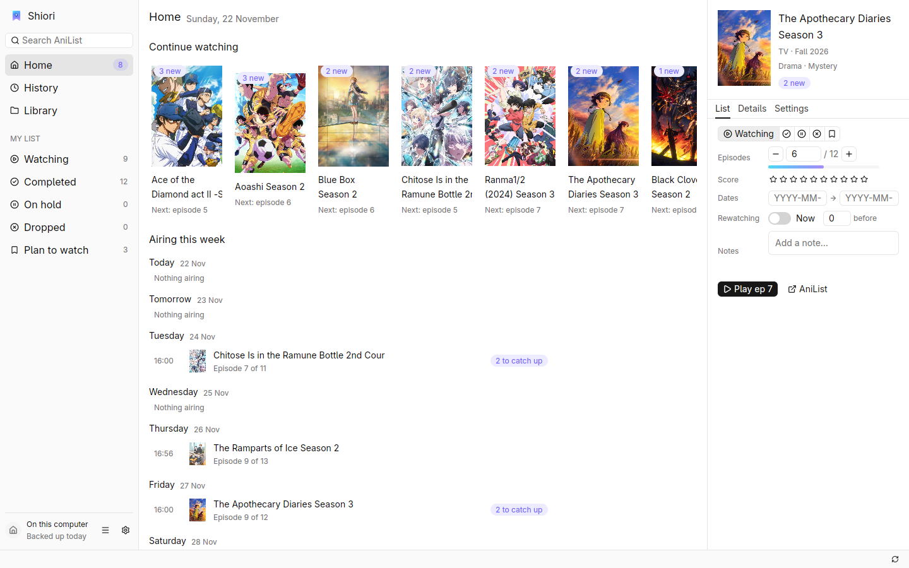
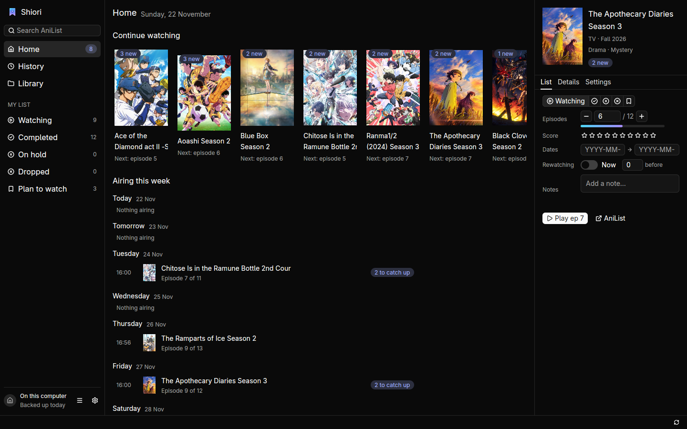
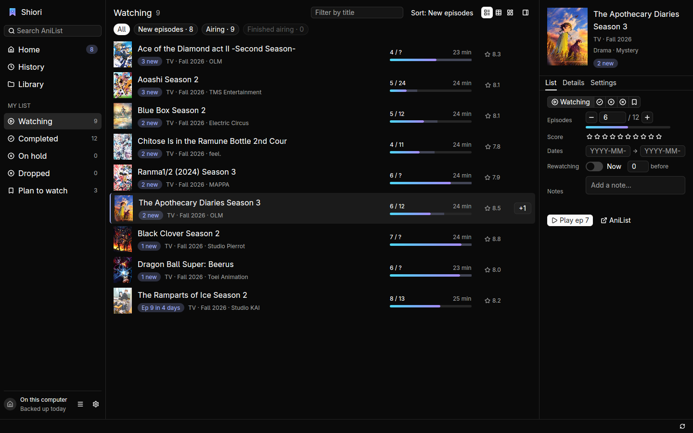
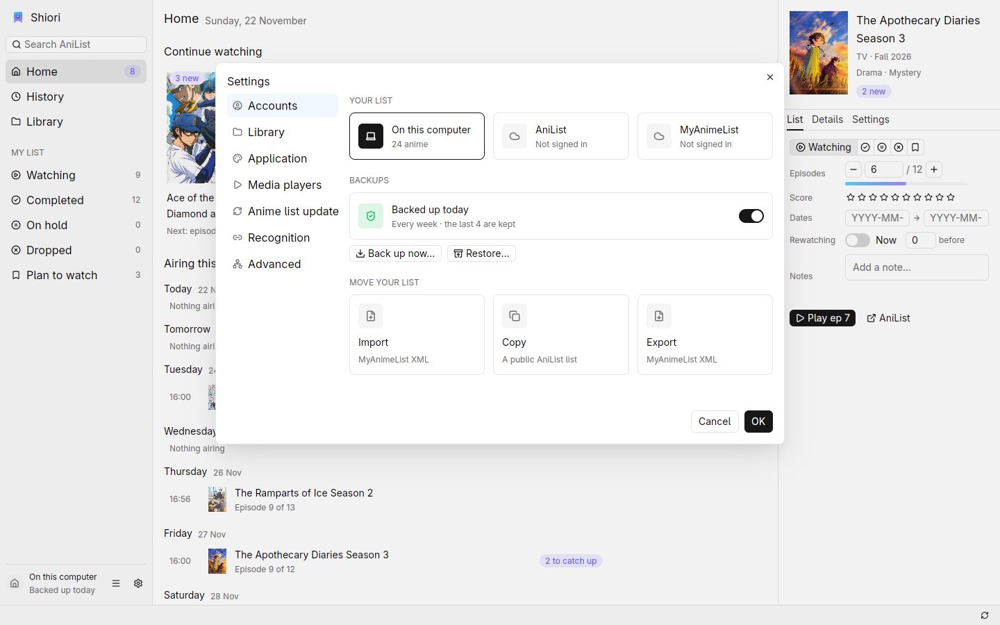
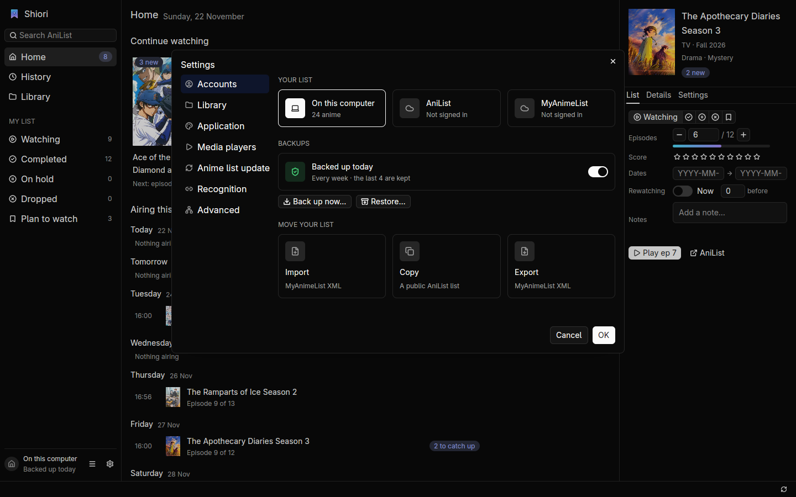

<div align="center">


# Shiori (栞 bookmark)

**Your bookmark for every anime you watch.**

Shiori is a desktop app for Windows and Linux that notices which anime episode you are playing, works out the series and episode from the file name, and updates your list for you. No more pausing the episode to open a browser tab and bump a counter from 6 to 7.

</div>

<picture>
  <source media="(prefers-color-scheme: dark)" srcset="docs/screenshots/list-dark.png">
  
</picture>

## Why Shiori

**It works with the player you already use.** Shiori knows several dozen media players, including mpv, VLC, MPC-HC, MPC-BE, PotPlayer, SMPlayer and Kodi. Keep watching the way you do now; Shiori follows along in the background. Watching in a web browser can be detected too, if you turn it on.

**It updates your list only when it should.** Shiori waits a couple of minutes to be sure you are really watching, then marks the episode watched and sends the change to your list. If the file looks like you skipped ahead (you were at episode 3 and now play episode 6), it asks first instead of guessing.

**You always know what to watch next.** The Home page shows the shows you have new episodes waiting for, and a week's airing schedule with how many episodes you need to catch up on. Every list row shows how many episodes are out that you haven't seen yet.

**Your anime folders become a library.** Point Shiori at the folders where you keep episodes. It recognizes the files, and "Play next episode" (Ctrl+N) opens the right file in your player. Can't decide? Ctrl+R plays a random show from your Watching list.

**No account needed.** Keep your list on AniList or MyAnimeList, or only on your computer. A list kept on your computer can import a MyAnimeList XML export or anyone's public AniList list, and can be uploaded to your AniList or MyAnimeList account later.

**Offline is fine.** Changes you make without a connection wait in a queue and go out the next time Shiori can reach the service.

**Native and fast.** Shiori is written in Rust and draws its interface with [gpui](https://www.gpui.rs/), the GPU-accelerated UI framework from the Zed editor. It is a real desktop app, not a web page in a wrapper. It follows your system's light or dark theme, and its tray icon shows at a glance whether what you are playing was recognized.

**Private by design.** Shiori reads only the name of the file your player has open, never the video itself. Browser detection is off until you turn it on, and then it reads only the title of the page in the detected browser window. Sign-in tokens go into your system keychain.

**Free software.** Shiori is licensed under the GNU General Public License, version 3 or later. No ads, no tracking, no subscription.

## Light and dark

Shiori follows your system theme, or you can pick light or dark in Settings.

| Light | Dark |
| --- | --- |
|  |  |
|  |  |
|  |  |

## Status

Shiori is in early releases. It works day to day, but some things are still missing:

- **List services:** AniList and MyAnimeList are supported. Kitsu is planned for a later version.
- **Installers:** there are no installers or distribution packages yet. The downloads below are the program in an archive.
- **macOS:** not supported.

## Download

Get the latest version from the [releases page](../../releases/latest).

**Windows:** download `shiori-<version>-windows-x86_64.zip`, unpack it anywhere and run `shiori.exe`.

**Linux:** download `shiori-<version>-linux-x86_64.tar.gz` and unpack it. Shiori needs GTK 3, Vulkan (it draws with the graphics card), xkbcommon and the Ayatana AppIndicator library for the tray icon. Most desktops already have them. On Debian and Ubuntu:

```sh
sudo apt-get install libgtk-3-0 libvulkan1 libxkbcommon-x11-0 libayatana-appindicator3-1
```

Then run `./shiori` from the unpacked folder. To add Shiori to your app menu, copy the files into place:

```sh
install -Dm755 shiori ~/.local/bin/shiori
install -Dm644 shiori.png ~/.local/share/icons/hicolor/1024x1024/apps/shiori.png
install -Dm644 shiori.desktop ~/.local/share/applications/shiori.desktop
```

## Building from source

You need Rust 1.88 or newer ([rustup](https://rustup.rs/) is the easiest way to get it).

On Linux, install the libraries gpui and the tray icon need. On Debian and Ubuntu:

```sh
sudo apt-get install libxkbcommon-dev libxkbcommon-x11-dev libwayland-dev libvulkan-dev \
  libx11-xcb-dev libxcb1-dev libfontconfig1-dev libfreetype-dev \
  libgtk-3-dev libayatana-appindicator3-dev
```

On Windows, install Visual Studio (or the Build Tools) with the "Desktop development with C++" workload, so that Rust can use the MSVC linker.

Then build and run:

```sh
cargo build --release --locked -p shiori-app
```

The app is `target/release/shiori` (`shiori.exe` on Windows). Run it without arguments to open the window. `shiori --help` lists the command-line mode (sign in, sync, list and edit entries without the window).

To try Shiori without touching your real data, set `SHIORI_HOME` to an empty folder. Shiori then keeps all its data, including sign-in tokens, in that folder.

## Documentation

The [product handbook](docs/domain.md) explains what Shiori does, from the user's point of view.

## Thanks to Taiga

Shiori is a Rust rewrite of [Taiga](https://github.com/erengy/taiga) by erengy, and follows Taiga's behavior closely. It is not affiliated with Taiga or its author. Shiori also ships two data files from erengy's projects: the media player list from [Anisthesia](https://github.com/erengy/anisthesia) (MIT) and the episode numbering relations from [anime-relations](https://github.com/erengy/anime-relations) (CC0). See [data/README.md](data/README.md).

## License

GNU General Public License, version 3 or later. See [LICENSE](LICENSE).

Anime titles, posters and descriptions shown in the app and in the screenshots come from [AniList](https://anilist.co) and belong to their respective owners.
